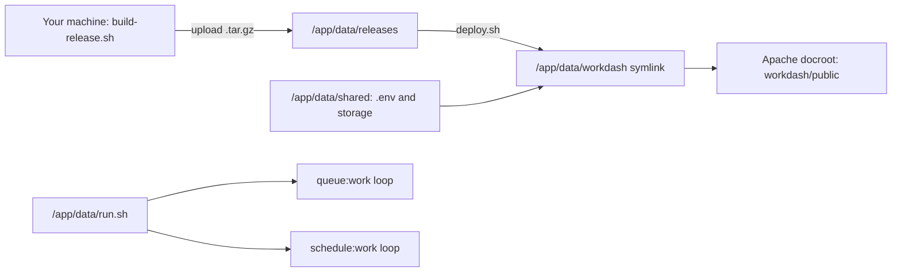

# Deploying to Cloudron

NPO.WorkDash runs on the [Cloudron LAMP app](https://docs.cloudron.io/packages/lamp/) with the MySQL addon, as decided in [ADR 0004](../adr/0004-hosting.md).

| App | Location | Cloudron app ID |
| --- | --- | --- |
| Production | <https://npo-workdash.apes.org.uk/> | `b253bb6f-f66a-49cc-aa7f-79464eebdc91` |

There is no staging app yet, so every release goes straight to production. A separate staging LAMP app can be added later with the same setup; when it exists, deploy each release to staging first.

Deployment is manual for now: you build a release archive on your machine, upload it, and run a script in the app's Web Terminal. The server needs neither Node nor Composer.

## Requirements

- A Cloudron server with **at least 8 GB RAM** (the app or apps, the shared MySQL server and Cloudron itself).
- **PHP 8.3 or later.** CI tests on 8.3, and the Composer lockfile targets 8.3. Set the LAMP app to 8.3 (see setup step 2).
- Each LAMP app's memory limit set to **1 GB** (the default 256 MB is too small for migrations and caching).
- On your machine: git, PHP 8.3+, Composer 2, Node 22+, and bash (Git Bash on Windows).

## How it fits together



| Path on the app | Purpose |
| --- | --- |
| `/app/data/releases/<release>/` | Extracted releases. `deploy.sh` keeps the newest 5. |
| `/app/data/workdash` | Symlink to the live release. Apache serves its `public/` directory. |
| `/app/data/shared/.env` | Environment for all releases (template: [`deploy/cloudron/env.example`](../../deploy/cloudron/env.example)). |
| `/app/data/shared/storage/` | Laravel storage (uploads, sessions, cache, framework files), shared by all releases. |
| `/app/data/run.sh` | Startup script: rebuilds the config cache and supervises the queue worker and scheduler. |
| `/app/data/deploy.sh`, `/app/data/rollback.sh` | Deploy and rollback scripts, copied from the repository. |
| `/app/data/apache/app.conf` | Apache site pointing at `/app/data/workdash/public`. |

Everything under `/app/data` is included in Cloudron's backups.

The database and mail credentials are not in `.env`: the app reads the addon's `CLOUDRON_MYSQL_*` and `CLOUDRON_MAIL_SMTP_*` variables (see [configuration and secrets](../security/secrets.md)). Because Cloudron can rotate these, `run.sh` rebuilds the config cache on every start.

## Deploy with the Cloudron CLI (recommended)

[`deploy/cloudron/cloudron-deploy.sh`](../../deploy/cloudron/cloudron-deploy.sh) does the whole of [Deploying a release](#deploying-a-release) from your machine, and most of the one-time setup. It needs the [Cloudron CLI](https://docs.cloudron.io/packaging/cli/) (`npm install -g cloudron`, then `cloudron login my.<cloudron domain>`) plus the build requirements above. Run it from Git Bash, or from PowerShell through Git Bash:

```powershell
& "C:\Program Files\Git\bin\bash.exe" deploy/cloudron/cloudron-deploy.sh v0.1.1
```

For a tag that exists on `origin`, the script:

1. builds the archive with `build-release.sh`
2. uploads it to `/app/data/releases/` with `cloudron push`
3. installs `run.sh`, `deploy.sh`, `rollback.sh` and the Apache config from that release, so script fixes ship with each release
4. runs `deploy.sh` on the app with `cloudron exec`, then restarts the app with `cloudron restart`
5. waits for `/up` to return 200 and checks that `/app/data/workdash/REVISION` matches the tag's commit, exiting with an error otherwise

On a fresh LAMP app, add `--bootstrap` once. It also sets `PHP_VERSION=8.3` and creates `/app/data/shared/.env` from the template, with `APP_ENV=production` and a newly generated `APP_KEY`. The key is never printed: copy it from the File Manager into the password manager. An existing `.env` is never overwritten. You still set the memory limit (setup step 1) in the dashboard, because the CLI cannot.

The defaults target production. Set `CLOUDRON_APP` (app ID or location) and `DEPLOY_URL` to deploy elsewhere, for example a future staging app.

## One-time setup (per app)

1. **Install the LAMP app** from the Cloudron App Store (production is at `npo-workdash.apes.org.uk`; a staging app could use `staging.npo-workdash.apes.org.uk`). Then, in the app's settings:
   - Resources: set the memory limit to 1 GB.
   - Email: keep the sendmail addon enabled so the app can send mail. Set the mail FROM address if needed.
   - Backups: confirm the app is included in the backup schedule.
2. **Pin PHP 8.3**: in the File Manager, change the `PHP_VERSION=` line in `/app/data/PHP_VERSION` to `PHP_VERSION=8.3` (new apps default to 8.4; keep the `;` comment lines), then restart the app. The scripts read the same line to pick the matching `php8.x` CLI.
3. **Build and upload the first release** (see [Deploying a release](#deploying-a-release), steps 1 and 2).
4. **Install the scripts and Apache config.** In the Web Terminal (as root):

   ```bash
   mkdir -p /tmp/rel && tar -xzf /app/data/releases/npo-workdash-<version>-<sha>.tar.gz -C /tmp/rel deploy/cloudron
   cp /tmp/rel/deploy/cloudron/{run.sh,deploy.sh,rollback.sh} /app/data/
   chmod +x /app/data/{run.sh,deploy.sh,rollback.sh}
   cp /tmp/rel/deploy/cloudron/apache-app.conf /app/data/apache/app.conf
   mkdir -p /app/data/shared
   cp /tmp/rel/deploy/cloudron/env.example /app/data/shared/.env
   rm -rf /tmp/rel
   ```

5. **Configure the environment.** Edit `/app/data/shared/.env` in the File Manager:
   - `APP_ENV=production` on production (`APP_ENV=staging` on a staging app).
   - Generate an `APP_KEY` with `php8.3 -r "echo 'base64:'.base64_encode(random_bytes(32)).PHP_EOL;"` and paste it in. **Store a copy of each app's key in the password manager**: without it, encrypted data cannot be recovered from a backup.
   - Staging uses Stripe test-mode keys and production uses live keys, once billing exists (M7).
6. **Deploy** the uploaded release (see below), then **restart the app** so Apache picks up `app.conf` and `run.sh` starts the worker and scheduler.
7. **Clear out the LAMP placeholder**: the default `/app/data/public/` directory is no longer served and can be deleted.

## Deploying a release

1. **Build the archive** on your machine from a tag (or any ref):

   ```bash
   deploy/cloudron/build-release.sh v0.1.0
   ```

   This creates `dist/npo-workdash-<version>-<sha>.tar.gz` with the code at that ref, production Composer dependencies and the built Vite assets.
2. **Upload** the archive to `/app/data/releases/` on the app, with the Cloudron File Manager or SFTP (details in the app's Documentation menu).
3. **Deploy** in the app's Web Terminal:

   ```bash
   bash /app/data/deploy.sh /app/data/releases/npo-workdash-<version>-<sha>.tar.gz
   ```

   The script:
   1. extracts the release
   2. links the shared `.env` and storage
   3. puts the live app into maintenance mode
   4. runs `package:discover`, `storage:link`, `migrate --force` and `optimize` (the config, route, view and event caches)
   5. switches the `workdash` symlink
   6. runs `queue:restart` and leaves maintenance mode
   7. prunes old releases
4. **Restart the app** from the Cloudron dashboard, so PHP's opcache serves the new code and `run.sh` re-caches config.
5. **Check it**: open the site, log in, and look at the app's Logs for `Starting queue worker`, `Starting scheduler` and a `Running ['artisan' app:heartbeat] ... DONE` line each minute.

If a staging app exists, deploy to staging, check it, then repeat the same archive on production.

If `deploy.sh` stops partway (for example a failing migration), the live symlink has not moved, but the site is still in maintenance mode. Fix the problem and re-run the deploy, or bring the old release back up with `php8.3 /app/data/workdash/artisan up`.

## Rolling back

```bash
bash /app/data/rollback.sh               # previous release
bash /app/data/rollback.sh /app/data/releases/<release>   # a specific one
```

Then restart the app. `rollback.sh` only switches code. It does **not** undo database migrations:

- If the newer release only **added** tables or nullable columns, the older code keeps working and no database action is needed. Prefer migrations like this (expand first, remove later).
- If a migration changed or removed something the older code needs, run `php8.3 /app/data/workdash/artisan migrate:rollback --step=<n> --force` **from the newer release, before** running `rollback.sh`. Check each migration's `down()` method first, because rolling back can drop data.
- As a last resort, restore the app from a Cloudron backup taken before the deploy. This also restores the database.

## Queue worker and scheduler

`run.sh` runs at container start (before Apache) and starts two supervised loops in the background, as `www-data` and with the Cloudron environment preserved:

- `queue:work --sleep=3 --tries=3 --max-time=3600` restarts within 5 seconds whenever it exits: hourly (`--max-time`), after `queue:restart` during a deploy, on a crash, or if the process is killed.
- `schedule:work` runs the Laravel scheduler every minute. The `app:heartbeat` command is scheduled every minute and logs `Scheduler heartbeat`.

Where logs go (with the `LOG_STACK=daily,stderr` setting from the env template):

- **Cloudron dashboard, Logs**: Apache, `run.sh` messages, the scheduler's `Running [...] DONE` lines, and application logs from web requests and the queue worker.
- **`/app/data/shared/storage/logs/laravel-YYYY-MM-DD.log`** (kept 14 days): everything above **plus logs from scheduled commands**. The scheduler discards a scheduled command's own output and stderr, so the `Scheduler heartbeat` line only appears in this file.

## Acceptance checklist

Run this after the first deploy to an app (staging first, if there is one), and tick it off on the GitHub issue:

- [ ] `https://<app domain>/` loads over HTTPS with a valid certificate, and `/login` shows the login page.
- [ ] Registering and logging in works, and the verification email arrives.
- [ ] `php8.3 /app/data/workdash/artisan about` shows the expected environment, PHP 8.3 and the MySQL connection. `/app/data/shared/.env` contains no `DB_*` credentials.
- [ ] **Queue**: `gosu www-data php8.3 /app/data/workdash/artisan app:queue-check`, then within a few seconds the Logs show `Queue heartbeat processed`.
- [ ] **Scheduler**: the Logs show `Running ['artisan' app:heartbeat] ... DONE` once a minute, and `grep "Scheduler heartbeat" /app/data/shared/storage/logs/laravel-*.log` shows matching entries.
- [ ] **Worker restart**: `pkill -f "artisan queue:work"`. Within about 5 seconds the Logs show `queue worker exited ... restarting` and then `Starting queue worker`, and `app:queue-check` still gets processed.
- [ ] **Rollback**: after a second deploy, `rollback.sh` switches back and the site still works.

## How the scripts were tested

Before the first real Cloudron deploy, the archive and scripts were exercised in Docker, using a `php:8.3-cli` container with `gosu` and the `CLOUDRON_MYSQL_*` variables pointing at a `mysql:8.0` container:

- The first deploy ran the migrations using only the Cloudron variables.
- `app:queue-check` was processed.
- A killed worker was restarted within 5 seconds and processed the next job.
- The scheduler ran `app:heartbeat` at the minute boundary.
- `/`, `/login` and `/up` returned 200 behind `X-Forwarded-Proto: https`, with `https://` asset URLs.
- A second deploy followed by `rollback.sh` restored the first release.

Apache, the LAMP image's startup sequence and the real addons still need the acceptance checklist above.

## Troubleshooting

- **`Killed` during deploy**: raise the app's memory limit (Resources) and retry.
- **500 error after deploy**: check the app's Logs. A missing `APP_KEY` or a typo in `/app/data/shared/.env` is the usual cause. After fixing `.env`, run `gosu www-data php8.3 /app/data/workdash/artisan config:cache` and restart.
- **Links or redirects use `http://`**: the app trusts Cloudron's proxy headers (`trustProxies` in `bootstrap/app.php`). Check that `APP_URL` is not overridden with an `http://` value.
- **Database connection refused after a restore or clone**: restart the app so `run.sh` re-caches the config with the new `CLOUDRON_MYSQL_*` values.
- **Interactive shells**: run artisan with `gosu www-data php8.3 ...` (not `su - www-data`, which drops the Cloudron environment variables), and always use `php8.3`, because the plain `php` CLI is pinned to the image default.
